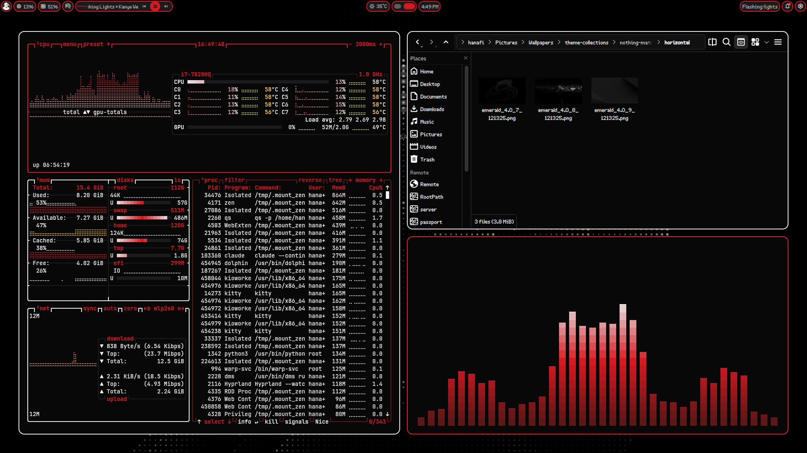
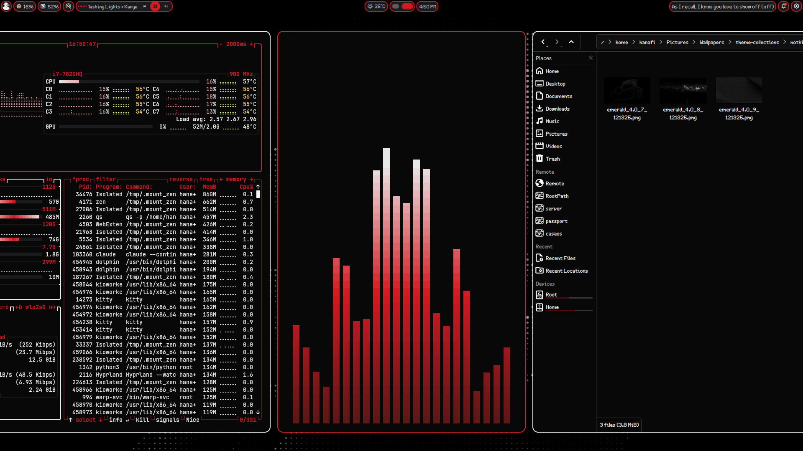

<div align="center">

# Fedora · Hyprland · DankMaterialShell

**A themeable Wayland desktop for a barebones Fedora, in one command.**






</div>

One screen. Everything opens ticked; untick what you do not want and press
Enter. `Space` toggles one item, `a` a whole group, `q` cancels. Nothing is
touched before Enter, and the password is asked once.

## 🎨 Themes

Three ship, and switching between them recolours **everything at once** through
[matugen](https://github.com/InioX/matugen): the shell, GTK 3/4, Qt 5/6, KDE
apps, foot, kitty, Neovim, btop, cava, fastfetch, starship, tmux, Zen, OBS, Obsidian
and Vesktop.

🔴 **Nothing Matrix** · 🟣 **Catppuccin** · 🟠 **Gruvbox Material**

The wallpaper follows too, picking a landscape or portrait image per monitor.
Add your own by dropping images into
`assets/wallpapers/<theme-slug>/horizontal/` and re-running.

**Open windows recolour where they can.** A watcher picks up each new palette
and reloads kitty, tmux, Dolphin and the other Qt and KDE apps, and GTK 3
programs, without closing anything. Vesktop and Obsidian watch their own
generated stylesheets. The browser is the exception: it reads its theme once at
startup, so it changes at the next launch.

## ✨ What you get

|                 |                                                                                                               |
| --------------- | ------------------------------------------------------------------------------------------------------------- |
| 🪟 **Desktop**  | Hyprland, scrolling or dwindle tiling, touchpad gestures, per-monitor workspaces                              |
| 🎛️ **Shell**    | DankMaterialShell: bar, launcher, notifications, control centre, lock screen, nine plugins                    |
| 🖼️ **Theming**  | matugen everywhere, themed wallpapers, matching login screen, optional boot splash                            |
| ⌨️ **Terminal** | zsh, oh-my-zsh, starship, fastfetch greeting, tmux, yazi, eza/bat/ripgrep/fd/fzf                              |
| 📦 **Apps**     | foot and/or kitty, any of Zen, Firefox, LibreWolf, Brave, Brave Origin, Vivaldi and Helium (you pick the default of each), Dolphin, Vesktop, Obsidian, OBS, qBittorrent, mpv, Strawberry, CLIAMP, EasyEffects |
| 🧑‍💻 **Dev**      | Neovim + LazyVim, podman, pyenv, nvm, rustup, Go, yt-dlp                                                      |
| 🔒 **Services** | Tailscale, Cloudflare WARP, a niri session, system tweaks                                                     |

Everything outside the base desktop is optional and shown in the checklist.

## 💿 Installing

### 1 · Fedora

Use the **Fedora Everything** ISO, not a spin: a spin brings a desktop of its
own that would fight this one. Anaconda's **Software Selection** screen decides
what you start from.

| Software Selection               | Choose                                            |
| -------------------------------- | ------------------------------------------------- |
| Base Environment                 | **Fedora Custom Operating System**                |
| Standard                         | ✅ tick                                           |
| Hardware Support                 | ✅ tick, or Wi-Fi and GPU firmware may be missing |
| Common NetworkManager Submodules | ✅ tick                                           |
| Guest Agents                     | ✅ only in a virtual machine                      |
| everything else                  | leave unticked                                    |

Also on the summary screen: set the hostname, switch the network **on** before
you start, leave the root account **disabled**, and tick **Make this user
administrator** for your own account. The installer needs sudo and never wants
a root login.

The first boot lands on a text console with no desktop. That is expected, and
it is what this repository is for.

### 2 · git

Nothing else is needed first, but the Custom base environment does not include
git, so install it and clone:

```sh
sudo dnf install -y git
git clone https://github.com/Jazzmedo/fedora-dms-hyprland
cd fedora-dms-hyprland
./install.sh
```

Run it as your own user, logged in at the console, never over `su` or a bare
SSH session: those have no user bus, and the shell's services cannot be enabled
without one. Everything else, including the graphics driver, is worked out and
installed for you.

## ⚙️ Options

```
--yes, -y          accept the default selection, ask nothing
--preset=NAME      minimal | standard | full
--gpu=VENDOR       amd | intel | nvidia | vm   (default: detected)
--layout=NAME      scrolling | dwindle
--terminal=NAME    foot | kitty              (default when both are ticked)
--browser=NAME     zen | firefox | librewolf | brave | brave_origin | vivaldi | helium
--only=A,B         run only these stages      --skip=A,B   run all but these
--dry-run          print every command without running one
--reset-selection  forget last run's choices  --status     what is installed
--no-backup        do not copy replaced files aside
--color=WHEN       auto | always | never      --list-stages
```

Re-running is safe: every step checks first, and anything replaced is copied to
`~/.fedora-nothing-backup/<timestamp>/`. To repair one part,
`./install.sh --only=themes`. Choices are remembered between runs.

Each step reports what it did, a failure never takes the run down with it, and
the run ends by checking outcomes rather than exit codes, since `chsh` can
succeed while the login shell stays put.

**On real hardware**, install in two passes so nothing that can stop you
reaching a desktop goes in untested:

```sh
./install.sh --dry-run             # the detected GPU, screens and plan
./install.sh --skip=sddm,optional  # everything that cannot break booting
./install.sh --only=sddm,optional  # then the login screen and boot splash
```

## 🛠️ Customising

```
lib/components.sh     the component registry — the single source of truth
lib/stages/           one file per stage, in the order it runs
config/desktop/       Hyprland modules, niri, systemd user units
config/shell/         zsh fragments, starship, tmux
config/theming/       matugen templates, GTK, Qt, KDE colour schemes
config/shell-ui/      DankMaterialShell settings and themes
config/tools/         btop, cava, fastfetch, yazi, cliamp
assets/               fonts, login theme, wallpapers, icons, boot splash
```

`.zshrc` is a loader; the content is in `config/shell/zshrc.d/`, one numbered
fragment per concern. `hyprland.lua` loads its own modules the same way.
Anything under `config/desktop/hypr/dms/` is written by the shell and will be
overwritten.

Deployed files are templated: `@@HOME@@`, `@@USER@@`, `@@MONITOR@@` and friends
are substituted, and a line ending in `@component:NAME` is dropped when that
component was not selected, so a keybinding for an app you did not install
simply does not exist.

After plugging in or removing a monitor, `./install.sh --only=hyprland` rewrites
the layout from the outputs the kernel reports.

### Browser extensions

`./browser-backup.sh` backs up or restores your browser extensions and their
data (Tampermonkey scripts, ShellTint styles, uBlock lists), picked from the
same checklist as the installer. Cookies and certificates can come along; they
force encryption with a passphrase. History and site data never do, so a backup
is tens of megabytes, not gigabytes. It runs on any distro, not only Fedora,
and finds Flatpak and Snap browsers too.

Backups go to `~/fedora-nothing-backups/` or a folder you choose, never inside a
git repository. The installer offers to restore one into the browsers it
installs. A Zen backup also restores into Firefox or LibreWolf, and a Brave one
into Vivaldi or Helium; Chromium extensions reinstall from the Web Store on the
first start and pick their data back up.

## 🚑 If something breaks

```sh
./doctor.sh                                    # check a finished install
./report.sh                                    # a redacted, pasteable report
journalctl --user -u dms-theme-wallpapers -n 40  # wallpaper not following
```

Logs and a manifest of every change land in `logs/` after each run.

**Stuck at a black screen after reboot?** It is the login screen, not the
machine. Press **ctrl-alt-F3** for a console, then:

```sh
journalctl -b -u sddm -n 50
sudo systemctl set-default multi-user.target && sudo reboot
```

## 🧹 Removing it

```sh
./uninstall.sh --dry-run     # show what would go, change nothing
./uninstall.sh               # ask once, then undo it
```

It reverses the manifests, then sweeps everywhere this installer and the
installers it runs can leave something. Replaced files come back from
`~/.fedora-nothing-backup/`. Paths outside what it owns and packages the system
needs are never touched, and anything refused is printed.
`--keep-packages`, `--keep-files` and `--recorded-only` narrow the run.

## 🙏 Credits

[DankMaterialShell](https://github.com/AvengeMedia/DankMaterialShell) ·
[matugen](https://github.com/InioX/matugen) ·
the SDDM theme by [Darkkal44](https://github.com/Darkkal44) ·
the clock plugin by [samgrande](https://github.com/samgrande/Dank-Nothing-Clock)
