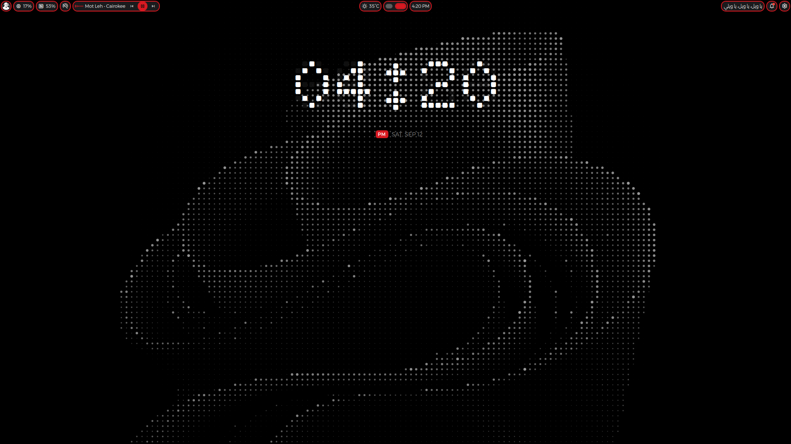

<div align="center">

# Fedora · Hyprland · DankMaterialShell

**A themeable Wayland desktop for a barebones Fedora, in one command.**




</div>

```sh
git clone https://github.com/Jazzmedo/fedora-dms-hyprland-setup
cd fedora-dms-hyprland-setup
./install.sh
```

One screen. Everything opens ticked; untick what you do not want and press
Enter. `Space` toggles one item, `a` a whole group, `q` cancels. Nothing is
touched before Enter, and the password is asked once.

## 🎨 Themes

Three ship, and switching between them recolours **everything at once** through
[matugen](https://github.com/InioX/matugen): the shell, GTK 3/4, Qt 5/6, KDE
apps, kitty, Neovim, btop, cava, fastfetch, starship, tmux, Zen, OBS, Obsidian
and Vesktop.

🔴 **Nothing Matrix** · 🟣 **Catppuccin** · 🟠 **Gruvbox Material**

The wallpaper follows too, picking a landscape or portrait image per monitor.
Add your own by dropping images into
`assets/wallpapers/<theme-slug>/horizontal/` and re-running.

## ✨ What you get

| | |
|---|---|
| 🪟 **Desktop** | Hyprland, scrolling or dwindle tiling, touchpad gestures, per-monitor workspaces |
| 🎛️ **Shell** | DankMaterialShell: bar, launcher, notifications, control centre, lock screen, nine plugins |
| 🖼️ **Theming** | matugen everywhere, themed wallpapers, matching login screen, optional boot splash |
| ⌨️ **Terminal** | zsh, oh-my-zsh, starship, fastfetch greeting, tmux, yazi, eza/bat/ripgrep/fd/fzf |
| 📦 **Apps** | kitty, Zen, Dolphin, Helium, Brave, Vesktop, Obsidian, OBS, qBittorrent, mpv, Strawberry, CLIAMP, EasyEffects |
| 🧑‍💻 **Dev** | Neovim + LazyVim, podman, pyenv, nvm, rustup, Go, yt-dlp |
| 🔒 **Services** | Tailscale, Cloudflare WARP, a niri session, system tweaks |

Everything outside the base desktop is optional and shown in the checklist.

## 💿 Fedora first

Install from the **Fedora Everything** ISO with the **Fedora Custom Operating
System** base environment, plus Standard, Hardware Support and the
NetworkManager submodules. Leave the rest unticked, keep the root account
disabled, and tick "Make this user administrator". The first boot lands on a
text console; that is expected.

## ⚙️ Options

```
--yes, -y          accept the default selection, ask nothing
--preset=NAME      minimal | standard | full
--gpu=VENDOR       amd | intel | nvidia | vm   (default: detected)
--layout=NAME      scrolling | dwindle
--only=A,B         run only these stages      --skip=A,B   run all but these
--dry-run          print every command without running one
--reset-selection  forget last run's choices  --status     what is installed
--no-backup        do not copy replaced files aside
--color=WHEN       auto | always | never      --list-stages
```

Re-running is safe: every step checks first, and anything replaced is copied to
`~/.fedora-nothing-backup/<timestamp>/`. To repair one part,
`./install.sh --only=themes`. Choices are remembered between runs.

Each step reports what it did, a failure never takes the run down with it, and
the run ends by checking outcomes rather than exit codes, since `chsh` can
succeed while the login shell stays put.

**On real hardware**, install in two passes so nothing that can stop you
reaching a desktop goes in untested:

```sh
./install.sh --dry-run             # the detected GPU, screens and plan
./install.sh --skip=sddm,optional  # everything that cannot break booting
./install.sh --only=sddm,optional  # then the login screen and boot splash
```

## 🛠️ Customising

```
lib/components.sh     the component registry — the single source of truth
lib/stages/           one file per stage, in the order it runs
config/desktop/       Hyprland modules, niri, systemd user units
config/shell/         zsh fragments, starship, tmux
config/theming/       matugen templates, GTK, Qt, KDE colour schemes
config/shell-ui/      DankMaterialShell settings and themes
config/tools/         btop, cava, fastfetch, yazi, cliamp
assets/               fonts, login theme, wallpapers, icons, boot splash
```

`.zshrc` is a loader; the content is in `config/shell/zshrc.d/`, one numbered
fragment per concern. `hyprland.lua` loads its own modules the same way.
Anything under `config/desktop/hypr/dms/` is written by the shell and will be
overwritten.

Deployed files are templated: `@@HOME@@`, `@@USER@@`, `@@MONITOR@@` and friends
are substituted, and a line ending in `@component:NAME` is dropped when that
component was not selected, so a keybinding for an app you did not install
simply does not exist.

After plugging in or removing a monitor, `./install.sh --only=hyprland` rewrites
the layout from the outputs the kernel reports.

## 🚑 If something breaks

```sh
./doctor.sh                                    # check a finished install
./report.sh                                    # a redacted, pasteable report
journalctl --user -u dms-theme-wallpapers -n 40  # wallpaper not following
```

Logs and a manifest of every change land in `logs/` after each run.

**Stuck at a black screen after reboot?** It is the login screen, not the
machine. Press **ctrl-alt-F3** for a console, then:

```sh
journalctl -b -u sddm -n 50
sudo systemctl set-default multi-user.target && sudo reboot
```

## 🧹 Removing it

```sh
./uninstall.sh --dry-run     # show what would go, change nothing
./uninstall.sh               # ask once, then undo it
```

It reverses the manifests, then sweeps everywhere this installer and the
installers it runs can leave something. Replaced files come back from
`~/.fedora-nothing-backup/`. Paths outside what it owns and packages the system
needs are never touched, and anything refused is printed.
`--keep-packages`, `--keep-files` and `--recorded-only` narrow the run.

## 🙏 Credits

[DankMaterialShell](https://github.com/AvengeMedia/DankMaterialShell) ·
[matugen](https://github.com/InioX/matugen) ·
the SDDM theme by [Darkkal44](https://github.com/Darkkal44) ·
the clock plugin by [samgrande](https://github.com/samgrande/Dank-Nothing-Clock)
